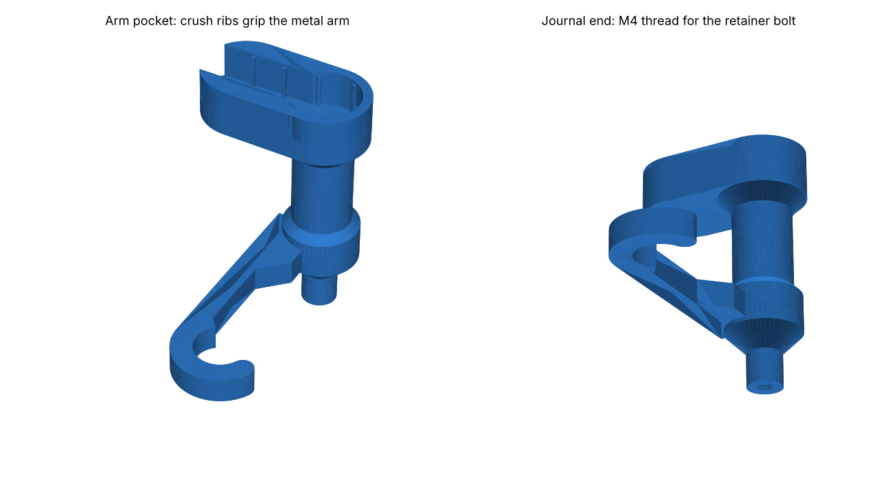
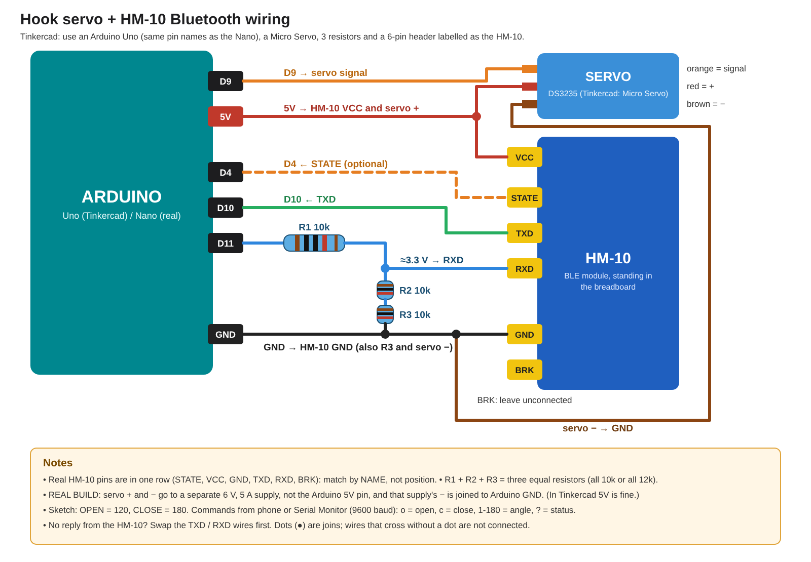

# Drone Payload Hook V2

A 3D-printed, servo-driven payload hook that mounts under a quadrotor drone. A **DSSERVO DS3235 (35 kg)** servo swings a hanging J-hook between a locked position and a drop position. An **Arduino Nano** drives it, and an **HM-10 Bluetooth** module lets you control it from a phone. Designed in Autodesk Fusion. Everything except the electronics and the servo is printable, including the bolts and nuts.

This release is mount version **v2.5**.

## Repository contents

| Path | What it is |
|---|---|
| `stl/` | All print files, already turned to their print orientation |
| `PRINT_LIST.txt` | Quantities, materials, slicer settings and assembly notes |
| `cad/Thingy_Hook_Mount_v2.5.f3d` | Fusion archive of the full assembly (with the hook joint) |
| `cad/Thingy_Hook_Mount_v2.5.step` | STEP of the full assembly, for other CAD tools |
| `firmware/Drone_Hook_HM10/` | Arduino sketch: phone / Serial Monitor control, slow close, calibration saved in EEPROM |
| `docs/images/` | Wiring diagram and renders |

## Parts to print

| # | File | Qty | Notes |
|---|---|---|---|
| 1 | `1_Top_Plate.stl` | 1 | Flat. 3 walls, 25% infill |
| 2 | `2_Hook_Frame_v2.5.stl` | 1 | Upside down as exported, **brim**. 4 walls, 40% gyroid |
| 3 | `3_Thingy_v3_Hook_v2.5_tight_fit.stl` | 1 | Arm-pocket face down, tree supports under the hook arm. **PETG or PC, 6 walls, 100% infill** |
| 4 | `4_Electronics_Box_v2.3_tall.stl` | 1 | Closed top down, no supports. 3 walls, 20% |
| 5 | `5_Electronics_Lid_Board_Tray_v2.3.stl` | 1 | Flat. 3 walls, 20% |
| 6 | `6_M6x16_Bolt_print_x12.stl` | 14 | 12 + 2 spare. Head down, 0.12 mm layers, 100%, PETG |
| 7 | `7_M6_Nut_print_x12.stl` | 14 | 12 + 2 spare. 0.12 mm layers, 100%, PETG |
| 9A | `9A_M4x14_Servo_Bolt_print_x4.stl` | 7 | 4 servo bolts + 2 spare + **1 for the hook retainer** |
| 9 | `9_M4_Servo_Nut_print_x4.stl` | 6 | 4 + 2 spare |
| 10 | `10_Hook_Retainer_Sleeve_print_x1.stl` | 2 | 1 + 1 spare. 0.12 mm layers, 100% |
| 9B | `9B_M4_Servo_Lock_Pin_print_x4.stl` | (6) | Optional alternative to 9A: pin with a hole for a safety wire |
| 8 | `8_Servo_Snap_Pin_print_x4.stl` | (6) | Optional: the original snap pins, which still fit |

Print **one M4 bolt and one M4 nut first** to check the thread fit. If they're tight, scale the bolt to 98% in X/Y; if loose, 101%. Metal M4 × 12–14 bolts and M4 nylock nuts also fit, and nylock nuts are the best against vibration. Every part fits a 256 × 256 mm bed.

## Parts to buy

- DSSERVO DS3235SG 35 kg servo with its 25T aluminium clamp arm
- Arduino Nano
- HM-10 BLE module (6-pin breakout: STATE, VCC, GND, TXD, RXD, BRK)
- 170-point mini breadboard
- 3 × 10 kΩ resistors (or 3 × 12 kΩ: they just need to be equal)
- 6 V, 5 A BEC or buck converter for the servo, plus a 1000 µF capacitor across it
- 6 × M3 screws to fix the top plate to the drone, plus jumper wires and zip ties

## Wiring

| From | To |
|---|---|
| Servo signal | Nano **D9** |
| Servo + / − | 6 V supply + / − (**not** the Nano's 5V pin). Join supply − to Nano GND |
| HM-10 VCC / GND | Nano 5V / GND |
| HM-10 TXD | Nano **D10** |
| HM-10 RXD | Nano **D11** through a divider: D11 → R → RXD, and RXD → R → R → GND |
| HM-10 STATE | Nano **D4** (optional) |
| HM-10 BRK | not connected |

## Firmware and phone control

Upload `firmware/Drone_Hook_HM10/Drone_Hook_HM10.ino`, which uses the built-in Servo, SoftwareSerial and EEPROM libraries.

| Command | Does | LightBlue hex |
|---|---|---|
| `o` | Open | `6F` |
| `c` | Close (slow, extra slow near the lock) | `63` |
| `1`–`180` | Go to that angle | e.g. 175 → `313735` |
| `+` / `-` | Nudge 1° | `2B` / `2D` |
| `so` / `sc` | Save the current angle as OPEN / CLOSE | `736F` / `7363` |
| `r` | Reset to the defaults (OPEN 50, CLOSE 120) | `72` |
| `?` | Status | `3F` |

**On iPhone, using LightBlue:**
1. Connect to **HMSoft**. The HM-10's light goes from blinking to solid.
2. Open service **FFE0** → characteristic **FFE1** and write the commands.
3. Tap **Subscribe** to see the replies.

The same commands work in the Arduino Serial Monitor at 9600 baud.

**Calibrating:** the servo numbers depend on how the arm sits on the spline. Move the hook with an angle and `+`/`-` until it just reaches the lock, then send `sc`. Do the same for open with `so`. The positions are saved in EEPROM. If the servo buzzes at either end, it is pushing on a stop, so move that position 1–2° toward the middle.

## Assembly (short version)

1. **Frame to top plate:** use 4 printed M6 bolts, heads in the hex pockets of the plate, with nuts under the frame ears.
2. **Hook in the frame:**
   1. Put the 8.3 mm bearing end into the far wall's hole.
   2. From outside that wall, push the **retainer sleeve** into the hole.
   3. Screw an **M4 bolt** through it into the hook's tip. The hook must still turn freely by hand.
3. **Servo:**
   1. Clamp the aluminium arm onto the spline.
   2. Turn the hook to its open position, so the arm pocket points up.
   3. Slide the servo in, arm first, so the arm presses into the hook's pocket. The crush ribs grip it.
   4. Fasten the 4 ears with the M4 bolts. The nuts sit in hex pockets on the inside of the wall.
4. **Electronics box:**
   1. Slide the M6 nuts into the side slots of the box ears.
   2. Bolt the box under the plate.
   3. The HM-10 stands up in the breadboard on the lid; the Nano zip-ties to the rail.
   4. Bolt the lid on from below.
5. **Mount** the plate to the drone with the 6 M3 holes. Check the landing gear clears the box.

## Safety features in this version

- **14 mm hook rod**, tapered at both ends. It survives a full 35 kg·cm servo stall at about 6 MPa (the old 8 mm rod reached about 34 MPa and snapped).
- **Rotation stops** on the frame. They catch the drive disc at about −1.25° and +96°, before the hook can hit the frame, so a servo overshoot never loads the rod or the hook arm.
- **Crush ribs and a retainer bolt** remove the hook's wobble and end play.
- **Bolted servo** with nuts that can't spin. The lock-pin option takes a safety wire.

## Version history

- **v2.5:** crush ribs in the arm pocket, 8.3 mm bearing journal, M4 retainer bolt and sleeve through the far wall.
- **v2.4:** 14 mm hook rod, inside-corner brace, over-rotation stops.
- **v2.3:** taller, wider electronics box (120 × 100 × 57 mm inside) so the HM-10 stands in the breadboard.
- **v2.2:** M4 bolt or lock-pin servo fasteners with hex nut pockets; bigger box.
- **v2.1:** DS3235 35 kg servo: bigger servo opening and a pocket for the aluminium arm.
